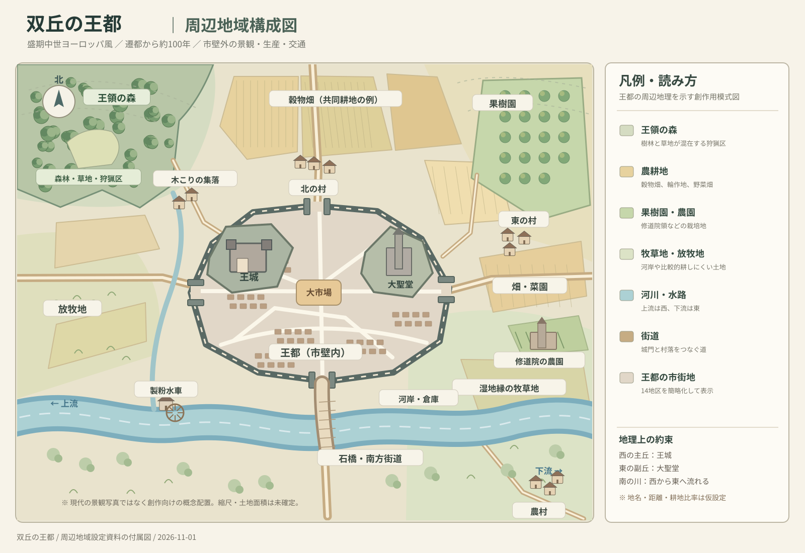

# 双丘の王都――周辺地域・自然・農村・交通の設定資料

> **位置づけ**：小説創作向けの架空都市設定。前編『双丘の王都――盛期中世ヨーロッパ風・首都設定資料』の補足資料。歴史上の一般的な傾向と、この王都のための創作上の提案を区別して記す。  
> **時代の参照範囲**：おもに11〜13世紀の西ヨーロッパ。農耕制度・王領林・集落形態には大きな地域差がある。  
> **既定条件**：約100年前に遷都した首都。西の主丘に王城、東の副丘に大聖堂、丘の間に市場、南に西から東へ流れる川と石橋がある。  
> **名称**：都市名・村名・森の固有名は未設定。以下の地名は役割を示す仮称。

## 目次

1. [周辺景観の結論](#1-周辺景観の結論)
2. [周辺地域の配置図](#2-周辺地域の配置図)
3. [史実上の骨格と地域差](#3-史実上の骨格と地域差)
4. [方角ごとの土地利用](#4-方角ごとの土地利用)
5. [王都から離れるにつれて変わる景観](#5-王都から離れるにつれて変わる景観)
6. [畑・農業・村の構造](#6-畑農業村の構造)
7. [王領の森と森林利用](#7-王領の森と森林利用)
8. [河川・水車・街道・物資の流れ](#8-河川水車街道物資の流れ)
9. [遷都から100年間で起こった変化](#9-遷都から100年間で起こった変化)
10. [四季と目に見える風景](#10-四季と目に見える風景)
11. [人物の移動と情景描写](#11-人物の移動と情景描写)
12. [物語に接続する設定の種](#12-物語に接続する設定の種)
13. [決めずに残す事項](#13-決めずに残す事項)
14. [歴史的参考資料・確認事項](#14-歴史的参考資料確認事項)

---

## 1. 周辺景観の結論

**採用案**：城壁を出ると、郊外の建物・菜園・果樹園があり、さらに穀物畑と村落が続く。西〜北西の丘陵には、樹林と開けた草地が混在する王領の狩猟地が広がる。南の川沿いは湿り気のある牧草地と水車が目立ち、東側には農園や修道院領を置く。

- 市壁のすぐ外が一面の原生林、という設定にはしない。王都は人口数万人を養うため、都市外から食料や燃料を集める必要がある。
- ただし「王都の周囲すべてが畑」という単調な景観にもせず、斜面・林地・草地・湿地・村落がモザイク状に入り込む。
- 町から見た遠景には、西の王領の森、北の畑と集落、南の川と橋、東のなだらかな畑と果樹園を入れる。
- 地域全体の気候は、温帯の西欧風とする。植物種や作物の比率は未決。

これらは**この王都のための提案**であり、西ヨーロッパの都市の周辺が必ずこの順序になるわけではない。

## 2. 周辺地域の配置図



[別ウィンドウで開く：周辺地域構成図（SVG）](royal_capital_surroundings.svg)

**図の約束**：上が北。王都内部は前編の「14地区の構成図」を縮約表示した。王城は西、大聖堂は東、市場は中央、石橋は南。川は西から東へ流れる。**図は地理関係を示すもので、距離・方位角・土地面積・収穫量・法的境界の精密図ではない。**

**前編の地図**：[王都地区構成図](royal_capital_city_plan.svg) ／ [王城内部配置図](royal_castle_inner_plan.svg)  
※ 前編のSVGを同じフォルダに配置した場合に開ける。周辺資料だけを持ち出しても本文と周辺地図は読める。

## 3. 史実上の骨格と地域差

### 3.1 畑と村は王都の生命線

盛期中世の多くの農業地域では、村・畑・牧草地・林地が相互に結びついた土地利用が見られた。農業地域に位置する大都市を描くなら、城壁の外に農地や人の住む土地が続くのは自然な選択である。穀物以外にも、家畜、薪、木材、干し草、野菜、酒・飲料用の原料が都市へ入ってくる。

### 3.2 「細長い畑」は地域限定の参考例

イングランドの一部では、村の共同耕地が多数の細長い耕作条に分割され、農家が複数の条を耕作する**開放耕地制（open-field system）**が広くみられた。耕起による畝と溝（ridge and furrow）の痕跡も残る。しかし西ヨーロッパ全域に一律の三圃制や条里状の畑を当てはめてはいけない。地域によって囲い地、小規模な分散農家、牧草地の比率などが違う。参照：[Historic England（耕地制度）](https://historicengland.org.uk/images-books/publications/iha-field-systems/)、[英国政府の畝・溝の解説](https://www.gov.uk/guidance/ridge-and-furrow-guidance-for-forestry-in-england)。

### 3.3 王領の「森」は必ずしも密林ではない

とくに中世イングランドの *royal forest* は、狩猟動物などを保護する特別な法的区域を指し、樹林だけでなく草地・畑・集落も含みえた。**「王領の森＝樹木の海」ではない**。この概念をそのまま他国の制度と同一視せず、架空王国の狩猟権・利用権のモデルとして取り入れる。参照：[Historic England（王領林・狩猟小屋）](https://historicengland.org.uk/listing/the-list/list-entry/1016524)、[English Heritage（ピークの森）](https://production.english-heritage.org.uk/visit/places/peveril-castle/history/)。

## 4. 方角ごとの土地利用

| 方角 | 主景観 | 具体的な施設・活動 | 物語上の役割 |
|---|---|---|---|
| **北西** | 丘陵の王領林、林間の草地 | 狩猟小屋、番人の住居、木こりの集落、細い林道 | 王の狩猟、密会、森の権利をめぐる事件 |
| **北** | 緩斜面の穀物畑と村落 | 農家、教区教会、納屋、共同耕地、牛馬の道 | 首都の食料供給、収穫、農民の来都 |
| **北東〜東** | 畑、果樹園、菜園 | 小村、修道院の農園、僧院へ通じる道 | 果実・薬草の供給、宗教施設との往来 |
| **南** | 川・橋・氾濫原・牧草地 | 製粉水車、川沿いの草刈り場、農道 | 水運、製粉、洪水、橋の通行管理 |
| **西** | 放牧地、畑、小さな林 | 家畜の道、牧人の小屋、木材運搬道 | 都市近郊の畜産、旅人が都を見る展望 |
| **南東の下流** | 低地、畑、河岸の続き | 船着き場、湿地縁の農家、場合によっては水を使う工房 | 荷運び、増水、生活排水や水利争い |

**地形上の優先順位**：低く湿った土地に牧草地、乾いた平坦地に畑、急な斜面や土の浅い場所に林・放牧地などを配置する。ただし実際の配置は土壌と地形によるため、機械的に分けない。

## 5. 王都から離れるにつれて変わる景観

距離は地図上で測定した値ではなく、**物語で距離感をそろえるための仮の設計帯**。土地利用は帯状にきれいに分かれず、同じ距離にも森や村が現れうる。

| 目安の距離（市壁から） | 見えるもの | 人や物の動き |
|---|---|---|
| **0〜500m程度** | 門前の宿、荷車置き場、菜園、果樹園、郊外の家屋 | 入城待ち、農産物を運ぶ人、城門衛 |
| **500m〜3km程度** | 畑、放牧地、小さな集落、農場、分かれ道 | 日常的に市場へ向かう農民、家畜、薪運び |
| **3〜10km程度** | 村落と大きな耕地、林地、修道院領、製粉所 | 村からの集荷、商人の巡回、農作業 |
| **10kmより外側** | 別の村々、荘園、森、丘陵、地方街道 | 穀物・木材・石材などの広域輸送 |

*注意*：都市人口数万人分の穀物を「半径10km内で全部賄う」とは決めない。収穫高や人口・耕地面積が未設定なので供給圏は算定できない。川舟や街道を利用した遠方からの輸送が必要になりうる。

## 6. 畑・農業・村の構造

### 6.1 農地の種類

- **穀物畑**：小麦、大麦、ライ麦、燕麦など。気候や地域によって主要作物が異なる。
- **野菜畑・菜園**：都市近郊や村の宅地に置く。収穫後にすぐ市場へ運べる利点がある。
- **果樹園・薬草園**：村の周辺、修道院の敷地、富裕層の所領など。果樹の種類は後日選ぶ。
- **草地・採草地**：冬の飼料となる干し草を取る。川沿いの湿り気のある土地を候補とする。
- **放牧地**：牛、羊、馬、豚などの飼養に用いる。森林の縁や共同利用地にも置ける。
- **休閑地**：輪作の組み方によっては作付けしない畑に家畜を入れることもできる。

**畑の見た目**：畝の向き、作付けが異なる色、地面の高さの差、畑を横切る小道、低い土手などが景観を分ける。現代のような四角い大区画・整然とした生け垣を当然の前提にしない。

### 6.2 北の村（サンプル）

| 場所 | 役割 |
|---|---|
| 村の広場または道の分岐 | 村人の往来、荷の積み替え、話し合い |
| 小教区教会 | 礼拝、共同体の儀礼、暦の目安 |
| 農家の家屋と庭 | 居住、家畜小屋、食料保存、畑仕事の道具 |
| 穀物畑 | 周囲に広がる耕地。個々の耕作権・土地保有は設定次第 |
| 村から王都への道 | 市場への作物輸送と税・地代の支払い |
| 製粉所（近くに水路があれば） | 穀物を粉にする。利用権や料金は支配制度に関わる |

**支配関係の設定案**：村の土地の一部を王領、一部を貴族や教会の所領とする。住民全員が王に直接属しているとは限らない。王都のすぐ近くでも、領主権や課税権の境界は複雑にできる。

### 6.3 生活のつながり

朝、村から野菜や穀物を積んだ荷車が街道を進む。市門の近くでは都市外の売買が行われ、城内の市場へ入る者もいる。帰路には塩、金物、布、あるいは都市の仕事の報酬を持ち帰る。都市住民と農村住民は、日々の取引を通じて結ばれている。

## 7. 王領の森と森林利用

### 7.1 北西の王領林の姿

- 遠くからは連続した森に見える部分があるが、内部には日当たりのよい草地が開ける。
- 大木のある区域、若木の林、低木地、放牧地、小川、狩猟道が混在する。
- 王の狩猟小屋と番人の詰所があり、都市の喧噪から離れた場所になる。
- 森の縁の村では、利用許可の範囲で薪や落枝の収集、家畜の放牧などを行う設定にできる。

### 7.2 「王の森」に置ける制度

| 権利・規制 | 設定例（創作） | 衝突の種 |
|---|---|---|
| 狩猟権 | 特定の獣は王または許可者だけが狩れる | 密猟、狩猟権の濫用 |
| 木材採取 | 建築用の大木を切るには許可が要る | 王城の増築と村人の生活の対立 |
| 薪・下草 | 村ごとに利用期間や採取範囲が決まる | 新参者への規制、権利文書の紛失 |
| 放牧 | 森の縁に共同利用の草地がある | 家畜の追い出し、森番との争い |
| 開墾 | 森の一部を畑へ変えるには承認が要る | 遷都による人口増と森林保護の衝突 |

この表は歴史上の一国の法令を再現したものではない。王国独自の狩猟法として採用・変更できる。

## 8. 河川・水車・街道・物資の流れ

### 8.1 南の川

川は**西が上流、東が下流**。都の南門から石橋へ下り、橋を渡った街道が南方の村落に向かう。東寄りの河岸には船着き場・倉庫があり、物流を支える。

- **石橋**：人・馬・荷車の通過点。橋の維持費、通行料、増水時の閉鎖などは創作上の制度として設けられる。
- **製粉水車**：上流側の支流または水流の安定した地点に置く。水路や堰の維持が必要。
- **採草地**：洪水を受ける低地の一部を、家畜用の干し草を取る場所にする。
- **河岸と船**：川が十分な水量・深さを持つなら、小舟や川舟で穀物・木材・石材を運ぶ。通年航行が可能かは未決。
- **衛生上の配置**：飲用水の取水場所と、排水負荷の大きい工房を分ける。実際には必ずしも徹底できず、争いの原因にもなる。

### 8.2 街道と都市の門

| 街道 | 王都との接続 | 通る人・物 |
|---|---|---|
| 北方街道 | 北門から穀物地帯へ | 村人、徴税関係者、穀物商 |
| 西方街道 | 西門から牧草地・王領林へ | 牧人、木こり、狩猟行列 |
| 東方街道 | 東門から村・修道院領へ | 果実や野菜を運ぶ者、巡礼・使者 |
| 南方街道 | 南門・石橋から川向こうへ | 荷車、家畜、市場へ向かう人々 |

王都に入る荷物がすべて同じ門に集中する必要はない。最も混雑するのは、交易上の重要な街道と市場を結ぶ門・橋・道路となる。

### 8.3 食料・燃料の流れ（設計メモ）

```
北の農村・遠方の穀倉地帯 ── 穀物 ──→ 製粉所 ── 粉・パン原料 ─→ 王都市場
近郊の菜園・果樹園 ────── 野菜・果実 ───────────────→ 王都市場
西の林地・周辺の村 ────── 薪・木材 ────────────────→ 工房・住宅・王城
南の採草地・農村 ─────── 干し草・家畜 ──────────────→ 厩舎・市場
川上・川下の交易拠点 ──── 船荷 ──────── 河岸 ─────→ 倉庫・商人街
```

この図は物流の種類の整理であり、輸送量や自給率の数値モデルではない。

## 9. 遷都から100年間で起こった変化

| 時期 | 都市外部の変化（創作案） | 残る痕跡 |
|---|---|---|
| **遷都以前** | 渡河地点、農村、森、田畑が既に存在 | 古い農道、村の教会、従来の地名 |
| **遷都後0〜20年** | 王城建設のため石材・木材・食料が集中 | 石切り場へ続く運搬路、建設労働者の集落 |
| **20〜50年** | 市場拡大とともに近郊に菜園・宿・荷車置き場が増える | 城門外の門前集落、改修された農道 |
| **50〜80年** | 大聖堂の建設と交易増加が周辺の物資需要を高める | 修道院の農園、採石・製材拠点、製粉施設 |
| **80〜100年** | 新市壁の外にも住宅や店舗が現れ、以前の畑が市街地化する | 新しい郊外と、土地を失う農民・地主の利害衝突 |

**重要**：遷都によって周辺地域がゼロから開発されたのではない。以前からの村や権利関係に、新しい王都の需要と行政が上書きされていく。

## 10. 四季と目に見える風景

| 季節 | 北の畑 | 西の森 | 南の川・牧草地 | 王都への流れ |
|---|---|---|---|---|
| **春** | 耕起・播種、若い芽 | 新緑、ぬかるむ林道 | 雪解けや雨による増水の可能性 | 種子、農具、薪などの需要 |
| **夏** | 一部の穀物の収穫、干し草作り | 青葉、木陰、放牧 | 牧草の刈り取り、水量の変化 | 穀物・野菜・果実などの搬入 |
| **秋** | 収穫後の畑、秋播き | 落葉、木の実、狩猟 | 冬に備えた燃料や食料の輸送 | 保存食と燃料の備蓄 |
| **冬** | 裸の畑や霜、地域によって雪 | 視界の開けた枝と冷たい風 | 凍結・増水・ぬかるみの可能性 | 倉に蓄えた穀物、乾燥した薪への依存 |

※ 栽培・収穫時期は作物や気候で変わる。春と秋のどちらに何を播くかも一律には決めない。

## 11. 人物の移動と情景描写

以下は**創作上の情景サンプル**。歴史資料からの引用ではない。

### 11.1 北方街道から入都する

北の村を出ると、しばらくは畑が続く。畝の色は区画ごとに違い、畑の間に家畜を引く人影がある。やがて遠い丘の上に王城の塔が見え、さらに東の大聖堂の鐘楼が姿を現す。農道が街道に合流するたび、荷車と人の数が増える。市壁が近づくと、畑は菜園や家屋に変わり、門の前には通行を待つ列ができている。

### 11.2 王城から郊外を望む

王城の西側の窓からは、なだらかな牧草地の向こうに暗い樹林が続いている。だが森は一様ではない。日光を受ける草地が幾筋も入り、林の間を縫う道に小さな人影が見える。北へ目を転じれば畑が淡い色の帯をつくり、村の教会がその境に立っている。

### 11.3 南門から川を渡る

南門を出ると、城内の細かな屋根並みが途切れ、川の風が吹きつけてくる。石橋の向こうでは、農夫が馬を引き、草を積んだ車が進む。橋の西では水車が回り、東の河岸には荷を降ろす人々の声が響いている。川を渡り終えると、王都の石壁は背後に遠ざかり、低い草地と畑の道が続く。

### 11.4 森の中へ進む

西の街道から枝道に入ると、樹々の陰が濃くなった。ところがほどなく森は切れ、陽光に満ちた草地が現れる。ここにも道があり、牛の足跡が残っている。遠くでは狩猟小屋の屋根が見え、王の森が人の営みから切り離された場所ではないことが分かる。

## 12. 物語に接続する設定の種

以下は採用を前提としない案。

1. **王領林の禁猟**：貧しい村人が狩猟禁止の獣を捕り、森番と衝突する。
2. **近郊農地の転用**：人口が増え、王都の門前に新しい家が建つ。耕地を手放したくない農民がいる。
3. **橋と通行料**：石橋の修理費や通行税が商人と村人の反発を招く。
4. **水車の権利**：上流の取水変更で下流の水車が回らなくなる。
5. **大聖堂の石材**：石切り場から続く道が重要な交易路に変わり、沿道の村が繁栄する。
6. **森と王の秘密**：狩猟小屋は宮廷から近く、都市の視線からは遠い密会場所になりうる。
7. **市場への穀物供給**：洪水や悪天候が長引き、王都のパン価格と民衆の不満が高まる。
8. **宗教領と王領の境界**：修道院の農園が王の新街道計画にかかり、交渉が必要になる。

## 13. 決めずに残す事項

- 王都の正式名称、王国名、村名、王領林の名称。
- 都市から海までの距離、川の流域規模・通航可能な船の種類。
- 主要作物、葡萄栽培や果樹の種類、冬の寒さ、降雪頻度。
- 王領林の法的制度、森林利用の許可者、罰則。
- 王都と周辺農地の人口、耕地面積、収穫量、自給率、輸送量。
- 土地の支配関係（王領、教会領、貴族領、都市自治領）。
- 地図の地形の細部、正確な標高、距離・縮尺、川の実際の幅。

**設定上の確定事項を増やしすぎず、物語に登場する場所から具体化する**のがよい。たとえば初めて森を舞台にする回で狩猟権や林道を決め、初めて村を舞台にする回で農地の細分や領主権を決められる。

## 14. 歴史的参考資料・確認事項

資料の説明は確認できた範囲に限定。主としてイングランドの考古学・歴史建築に関する公的資料であり、架空王国全域への普遍的な根拠ではない。

1. **Historic England, *Field Systems*（2018）**：古代から中世以降までの畑の制度・耕地景観を説明。中世の開放耕地と村落の関連を考える資料。  
   https://historicengland.org.uk/images-books/publications/iha-field-systems/
2. **UK Government, *Ridge and furrow guidance for forestry in England*（2026）**：畝と溝、湾曲する中世の耕地形状、後世の変化を説明。  
   https://www.gov.uk/guidance/ridge-and-furrow-guidance-for-forestry-in-england
3. **Historic England, *Medieval Settlements*（2018）**：農家・小集落・村などの類型と集落の変化を紹介。  
   https://historicengland.org.uk/images-books/publications/iha-medieval-settlements/
4. **Historic England, *Medieval hunting lodge in Queen Bower*（登録資料）**：中世イングランドの王領林は法的・行政的区域で、森が樹木だけで構成されないことを説明。  
   https://historicengland.org.uk/listing/the-list/list-entry/1016524
5. **English Heritage, *History of Peveril Castle*（王領林の説明）**：王領林が狩猟・資源管理の対象だったことを説明。  
   https://production.english-heritage.org.uk/visit/places/peveril-castle/history/
6. **Historic England, *Mills*（2018）**：歴史的水車・風車の基本構造と遺構を紹介。  
   https://historicengland.org.uk/images-books/publications/iha-mills/
7. **Historic England, *Nether Adber deserted medieval village*（遺跡登録）**：村の広場、道、家屋敷地、果樹園だった可能性のある区画の実例。  
   https://historicengland.org.uk/listing/the-list/list-entry/1008251

**史実と創作の境界**：農地・集落・王領林・水車が中世の景観と結びつくことは歴史資料で確認できる。一方、この王都の方角別配置、距離帯、村の位置、権利制度、遷都後の年表、景観描写は**架空都市のために設計したもの**であり史実の地理を復元したものではない。

---

**付属ファイル**：`royal_capital_surroundings.svg`  
**既存資料との接続**：`royal_capital_worldbuilding.md`、`royal_capital_city_plan.svg`、`royal_castle_inner_plan.svg`  
**作成日**：2026-11-01（日本時間）
