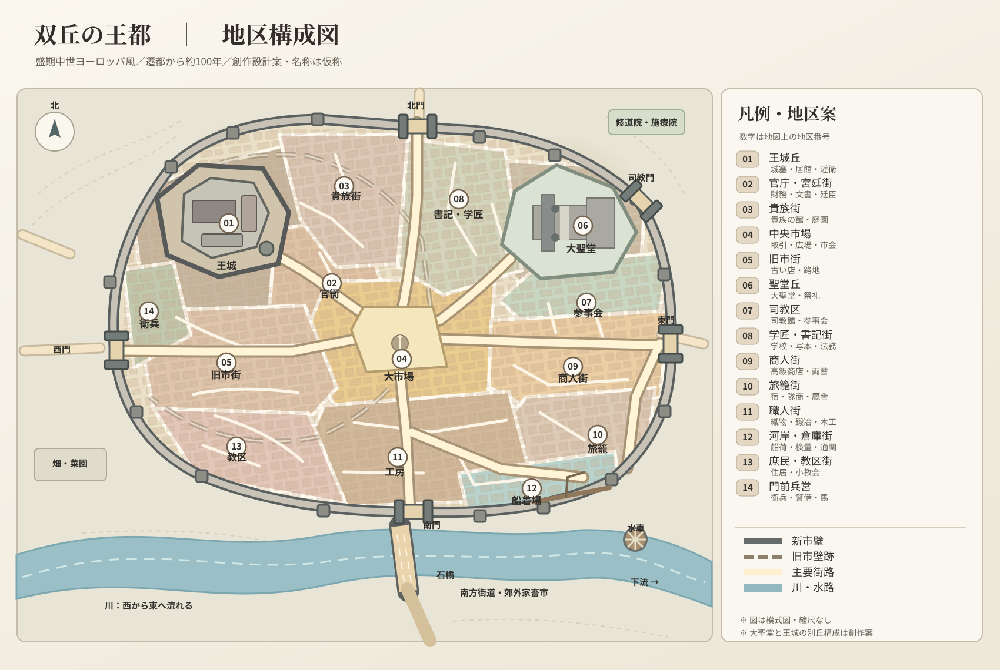
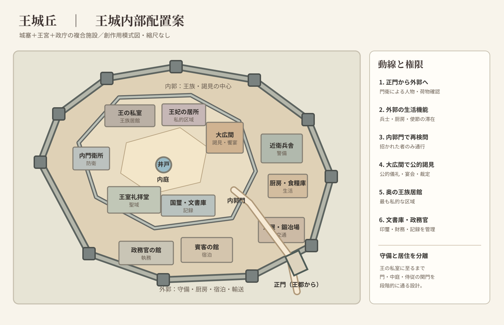

# 双丘の王都――盛期中世ヨーロッパ風・首都設定資料

> **位置づけ**：小説創作用の都市設計案。地名・国名・宗教名は未確定で、ここにある名称は機能を示す仮称である。実在都市を復元したものではない。
>
> **採用方針**：「西の主丘に王城、東の副丘に大聖堂」を中心とし、遷都から約100年を経て成熟しつつある王国の首都を描く。
>
> **想定時代**：盛期中世後半、特に13世紀の西ヨーロッパを主な比較対象とする。魔法・宗教制度・王国の性質に応じて変更可能。

## 目次

1. [完成イメージと地図](#1-完成イメージと地図)
2. [舞台の前提と地形](#2-舞台の前提と地形)
3. [遷都から100年間の発展](#3-遷都から100年間の発展)
4. [都市の規模と人口](#4-都市の規模と人口)
5. [14地区の詳細](#5-14地区の詳細)
6. [王城とその内部](#6-王城とその内部)
7. [大聖堂と宗教地区](#7-大聖堂と宗教地区)
8. [城壁・城門・道路](#8-城壁城門道路)
9. [河川・橋・物流と水利](#9-河川橋物流と水利)
10. [生活と建築の描写](#10-生活と建築の描写)
11. [統治・社会・儀礼](#11-統治社会儀礼)
12. [物語で使える場所と事件](#12-物語で使える場所と事件)
13. [情景描写サンプル](#13-情景描写サンプル)
14. [未決事項と調整の余地](#14-未決事項と調整の余地)
15. [史実に関する注記・参考資料](#15-史実に関する注記参考資料)

---

## 1. 完成イメージと地図

### 都市全体



[SVGを単独で開く：王都の地区構成図](royal_capital_city_plan.svg)

**基本構造**：

- **西の主丘**には城塞・王宮・政庁の機能を併せ持つ王城。外城壁とは別に独立した防御線を持つ。
- **東の副丘**には大聖堂。司教館、参事会、宗教学校、施療活動などがその周囲に集まる。
- **二丘の間の鞍部と緩斜面**には中央市場、商人の店舗、役人の執務施設。王都の政治・商業・宗教の往来が交差する。
- **北側の高めの地勢**には貴族街、廷臣の住居、書記官・教師の地区。
- **南側の低地**には職人街、河岸、倉庫、比較的密集した住居。
- **南の河川**には石橋を設け、橋の北端に主要な城門。橋を渡った先は穀倉地帯と街道へ続く。
- **旧市壁跡**は王城と古い市場周辺を囲むように残り、外側には発展後に築かれた新市壁がある。

**景観の核**：遠くからは王城の塔と大聖堂の鐘楼が別々の丘に並び、その下に屋根の海、市壁、川、石橋が見える。二つの高所は、それぞれ世俗の王権と宗教的権威の象徴である。ただし宗教と王権が必ず対立するわけではない。

### 王城内部



[SVGを単独で開く：王城の内部配置案](royal_castle_inner_plan.svg)

図はいずれも**縮尺なしの編集可能なSVG**。図上の方位は上が北。地区の輪郭、道路、施設の細部は物語の必要に応じて変更してよい。特定の地形図や史跡図をトレースしたものではない。

## 2. 舞台の前提と地形

### 2.1 王都に選ばれた理由

遷都当時、この地域には二つの丘に挟まれた谷と、その南の川を渡る交通の要所があった。完全な無人の土地ではなく、小規模な市場集落、渡し場または古い橋、農村が点在していたとする。**現在の「王都」は遷都を機に初めて大都市になった**という意味で、「100年前にできた場所」という設定を維持できる。

王が遷都を決めた理由は、複数を重ねると説得力が増す。

- 主丘が防衛に優れ、王城を築ける。
- 川と街道を押さえることで、徴税と物資の集積を管理できる。
- 旧都より王国内の交通や政治的勢力の分布に適している。
- 副丘に大聖堂を置くことで、新しい都の正統性と威信を示せる。
- 宮廷・行政官・軍・聖職者を集めることで、新都市の経済を育成できる。

政治的な動機は未決とする。旧都の貴族への牽制、国境変更、王朝交代、災害、神託など、作品に応じて選択する。

### 2.2 地勢

| 地点 | 地勢 | 立地の意味 | 注意点 |
|---|---|---|---|
| 西の王城丘 | 独立性の高い岩盤の丘。周囲より高い | 見張り、防御、権威の視覚化 | 井戸・貯水池と補給路が必要 |
| 東の聖堂丘 | 広い頂部または緩い肩を持つ丘 | 大規模聖堂・儀礼空間の確保 | 建設資材の運搬、建物の基礎 |
| 二丘の中間 | 緩斜面や鞍部 | 市場・主要道路・群衆の集まりやすさ | 豪雨時の排水を考える |
| 南の低地 | 平坦で川に近い | 荷車、工房、河岸、倉庫に便利 | 浸水・汚水・火災の問題 |
| 北の外縁 | 畑、果樹園、比較的乾いた台地 | 菜園、貴族屋敷、都市への食料供給 | 市街の成長による土地転用 |

**地勢を優先するルール**：王城に防衛力、大聖堂に広い敷地、市場に交通の利便性、港に平地と水深を与える。美しい左右対称の平面図にするために、坂や川を無視しない。

### 2.3 気候と見た目

温帯の西欧風気候を仮定。石灰岩・砂岩などの石材が近郊で得られるなら、王城、大聖堂、市壁、富裕層の建物に石が多く使われる。庶民の住宅は木材、木骨と塗り壁、瓦や板葺きなどが混じる。**白い石の高所と赤褐色・灰色の屋根が密集する低所**という色彩を基本案にする。

## 3. 遷都から100年間の発展

現代の行政計画都市のように一度で完成するのではなく、約100年間に生まれた複数の計画と自発的発展が重なった都市とする。

| 年代（遷都を0年とする） | 王権の事業 | 都市の変化と痕跡 |
|---|---|---|
| 遷都以前 | 小さな橋市場・渡河施設が存在 | 後の旧市街に斜めの古道が残る |
| 0〜10年 | 主丘に王の居所、仮の木造・石造防御施設。役人や兵の宿営 | 王城への坂道と軍用道路が優先される |
| 10〜25年 | 王城を石造で拡張。王の市場特権と課税制度を整える | 最初の市場、初期の市壁、旧街区の形成 |
| 25〜50年 | 副丘に大聖堂の本格建設。司教区と聖職者住宅の整備 | 聖堂坂が通りとなり、建設労働者・石工が定住 |
| 50〜75年 | 石橋の整備、河岸・造幣・役所などの機能拡充 | 商人街や工房街が広がり、城壁外に郊外集落ができる |
| 75〜95年 | 新市壁を建設し、旧市街・新市街・聖堂丘をひとまとまりに囲う | 旧市壁の一部と門が市内の通路や地名として残る |
| 95〜100年 | 王城の居住設備改良、大市場の整理、街路と水利の補修 | 新市壁の外にも市場・宿・菜園が増え始める |

**重要**：完成した大聖堂がある必要はない。聖堂の身廊が使われながら、正面や塔がなお工事中、という状況も100年都市らしい。城は複数世代の増築で平面が少し歪んでよい。遷都がもたらした「整った主軸」と、実際の居住者が生み出した「入り組んだ横道」を共存させる。

### 3.1 旧市街と新市街の差

**旧市街**には低い石壁、古井戸、幅の不揃いな街路、長く続く商家、昔の橋道が残る。もともとの地権者や古参商人が住むため、遷都後の新興貴族に複雑な感情を持つ者もいる。

**新市街**には王や都市当局が地割りした比較的整った通りが見られる。ただし街路に面した細長い敷地は後から細分化・建て増しされ、裏路地や共同の中庭が生まれる。100年も経てば「新しい地区」の内部にも十分な雑然さがある。

## 4. 都市の規模と人口

この節の数字は**史料から特定都市の数値を移植したものではなく、創作上の設計パラメーター**である。

| 項目 | 暫定設定 | 意味 |
|---|---:|---|
| 城内外を合わせた常住人口 | **約4万〜6万人** | 王国有数の大都市。季節の市や祭礼時は一時人口が増える |
| 新市壁内の人口 | **約3万5千〜5万人** | 日常の都市機能の中心 |
| 市壁内の面積 | **約2.5〜3 km²** | 市壁、庭、聖堂区、市場、建物敷地を含む |
| 市街地の東西幅 | **約2.3 km** | 坂や道路の湾曲で移動距離は長くなる |
| 市街地の南北幅 | **約1.7 km** | 低地と丘の起伏を含む |
| 市壁の概算延長 | **約6〜7 km** | 地形により変動する |
| 城門 | **主要5門＋河岸の小門** | 警備、通行、徴税、防衛を兼ねる |
| 市内の主要地区 | **14地区** | 地区割は行政境界と必ずしも一致しない |

**縮小案**：首都であっても交易規模を抑えたいなら、常住人口を2万〜3万人へ下げ、河岸・宿屋・新市街を小さくできる。逆に10万人近い都市にするなら、水運・食料供給・市壁外の人口・土地不足を一段と強調するとよい。

## 5. 14地区の詳細

地区番号は都市SVGの円内数字と対応。地区名は名称案ではなく、役割を把握するための機能名とする。

| 番号 | 地区 | 位置・主な建物 | 主な人々・活動 | 物語での使いどころ |
|---|---|---|---|---|
| **01** | **王城丘** | 西の主丘。王城・門・守備塔・城内庭 | 国王、王族、近衛、宮廷人、従者 | 王の密談、謁見、包囲、政変 |
| **02** | **官庁・宮廷街** | 王城坂の下。財務官や文書官の館、御用商人の店 | 書記、財務官、裁判関係者、廷臣 | 勅書の発行、訴訟、情報の収集 |
| **03** | **貴族街** | 北側の高台。塀付きの屋敷、馬屋、小庭 | 宮廷貴族、地方領主の滞在家族 | 晩餐会、婚姻交渉、派閥抗争 |
| **04** | **中央市場** | 二丘の中間。取引広場、市会施設、検量所 | 商人、都市役人、職人、買い物客 | 王の布告、群衆、祝祭、暴動 |
| **05** | **旧市街** | 王城西南〜市場西。古い井戸、古道、教区教会 | 古参商家、地主、職人、庶民 | 隠れ家、伝承、遷都以前の痕跡 |
| **06** | **聖堂丘** | 東の丘。大聖堂、石工の作業場、祭礼前庭 | 司教、高位聖職者、参詣者、石工 | 国家的宗教儀礼、葬儀、聖域 |
| **07** | **司教区** | 聖堂丘の南東。司教館、参事会、教会付属施設 | 聖職者、書記、学生、施療者 | 王権と宗教勢力の交渉、聖堂文書 |
| **08** | **学匠・書記街** | 北側の鞍部。学校、写本工房、法務関係の住居 | 教師、書記、学生、法律家 | 古文書、裁判、学問上の論争 |
| **09** | **商人街** | 市場東の幹線道路。布・香辛料・金属製品の商店 | 富裕商人、両替商、仲介人 | 密輸・取引・商業同盟の駆け引き |
| **10** | **旅籠街** | 東門から河岸へ向かう道沿い。宿、厩舎、荷車置場 | 旅人、隊商、伝令、傭兵 | 初登場人物の入都、噂、潜入 |
| **11** | **職人街** | 南の低地。織物、木工、金工などの工房 | 職人、徒弟、働く家族 | 労働争議、失火、技術や道具の入手 |
| **12** | **河岸・倉庫街** | 南東河岸。荷揚げ、倉、検量所、桟橋 | 船頭、仲買、荷役、税吏 | 密航、盗品、貨物検査、火災 |
| **13** | **庶民・教区街** | 南西。密集住宅、小教会、共同井戸、パン焼き場 | 小商人、日雇い、職人の家族 | 日常生活、失踪、地区住民の連帯 |
| **14** | **門前兵営** | 西門付近。門衛、詰所、馬具保管、兵の宿所 | 都市守備兵、通行監視人、伝令 | 検問、逃走、夜の門限、警備の抜け穴 |

### 5.1 地区は「純粋な用途地域」ではない

「商人街に住居がない」「貴族街に職人が入れない」という厳密な分離にはしない。商家は**一階が店舗、二階以上が住居**という構造でもよく、工房の横に家族が住み、宿屋の隣に教会があっても自然である。地図の色は**その地区で相対的に優勢な機能**を表す。

### 5.2 城外の補助地区

- **北・北東の修道院／施療院**：巡礼者、病者、旅人の世話をする。修道院と施療院が同一組織である必要はない。
- **南の橋詰市・家畜市**：大きな動物や長距離輸送用の荷車が滞留し、都市内部の過密を避ける。
- **川の下流側の水車・染革地区**：水車、染色、革なめしなど水利用や排水負荷の大きい作業の候補。ただし配置は水量・風向・上流取水の位置次第。
- **郊外の畑と菜園**：日持ちしにくい野菜、果実、家畜の飼育。都市住民の食料は城壁内で自給するわけではない。

## 6. 王城とその内部

王城は**城塞・王宮・政庁**を重ねた施設とする。13世紀の王城は、ただ一つの巨大な住居棟ではなく、守備施設、庭、複数の居館、礼拝堂、厨房、倉庫などの集合体として描くと扱いやすい。

### 6.1 王城の外部構造

1. **城下の坂道**：王城門へ至る大路。道幅は都市の中心街より狭まる箇所があり、最後に折れ曲がる。
2. **王城正門**：堅牢な門楼、門衛室、場合によっては跳ね橋や溝。市民は無条件には通れない。
3. **外郭（外庭）**：兵舎、厩舎、厨房、倉庫、荷車、修理施設、来客の滞在施設。
4. **内郭門**：門衛と侍従の検問。高官、使者、謁見の許可を受けた者が通る。
5. **内郭**：王の居館、大広間、王妃の部屋、王室礼拝堂、重要書類と印璽の管理区域。
6. **最奥の私的区域**：王の寝所、私室、限られた近臣の控室。政治的な密談と王族の日常が交差する。

### 6.2 王城内の部屋・施設

| 施設 | 場所の候補 | 役割・描写 |
|---|---|---|
| 大広間（グレート・ホール） | 内郭の手前側 | 謁見、裁定、饗宴、儀礼。王の権威を視覚化する |
| 大広間に隣接する控室 | 大広間の側面 | 次の謁見を待つ者、侍従、使節が集まる |
| 王の居館・私室 | 内郭の奥 | 護衛が厳しく、入室できる者が限られる |
| 王妃・王族の居館 | 王の居館に近い別棟または一角 | 家政と宮廷の人間関係が展開する |
| 王室礼拝堂 | 内郭 | 王族が私的・公式に礼拝する。大聖堂とは役割が違う |
| 財務・印璽・文書庫 | 内郭または官庁街 | 命令・金銭・記録の管理。重要性の異なる書類は分けて保管してもよい |
| 厨房・食糧庫・酒蔵 | 外郭 | 大人数の食事を支え、職人と従者が絶えず働く |
| 厩舎・鍛冶場 | 外郭の出入り口近く | 馬の世話、馬具や工具の修理、急使の出発 |
| 兵舎・武具庫 | 外郭と城門付近 | 近衛兵と守備兵の詰所 |
| 井戸・水槽・貯水施設 | 内郭および外郭 | 包囲時の生命線。高台の城の最大の制約のひとつ |
| 来客の宿所 | 外郭 | 地方領主、使節、随員の宿泊。ただし人数に応じて都市の宿も使う |

**警備の段階**：市街地 → 王城正門 → 外郭 → 内郭門 → 大広間 → 王族居館、という順に人が減り、許可が厳しくなる。謁見できることと王の私室に入れることは違う。これは潜入や政治劇の演出にも役立つ。

**中世らしい注意**：王が首都に常駐するとは限らず、宮廷が移動する期間もあり得る。首都に政庁機能が集中していても、「王の所在」と「行政の所在地」を分けられる。史実のイングランドでも、12〜13世紀を通じて王室の移動から恒常的な機関への移行が進んだ。[参考5・6]

### 6.3 王城の視覚的性格

- 城壁と塔は街の屋根を見下ろす。見張りは橋や主要街道の交通を監視できる。
- 王の居館は軍事上の塔より居住性を重視し、暖炉、彩色された壁面、布張り、ガラス窓などを一部に備えられる。
- 中庭には作業する従者、武装した衛兵、伝令、厩務員が混在する。
- 城壁の高所から、東の大聖堂の塔と南の川が見える。

## 7. 大聖堂と宗教地区

### 7.1 大聖堂の基本構成

- **大聖堂本体**：祭壇、身廊、内陣、鐘楼、場合によっては地下祭室や聖遺物の安置場所。
- **聖堂前庭**：巡礼者、儀礼、王の行列、布告などに使える空間。通常の中央市場とは別。
- **司教館**：司教が居住・執務する建物。王とは異なる権威と人脈を持つ。
- **参事会の建物・住居**：聖堂の典礼や財政、施設管理に関わる者の活動場所。
- **学校・文書室**：聖職者の教育、聖典の写本、記録の保管。
- **施療・救貧施設**：教会組織や寄進に支えられる福祉の場。ただし各施設の運営主体は区別できる。
- **建設資材置き場**：石工、彫刻師、足場。100年経っても建築が続く設定と相性がよい。

### 7.2 王城との違い

| 王城丘 | 聖堂丘 |
|---|---|
| 王の命令、世俗の統治、軍事 | 儀礼、信仰、宗教的な正統性 |
| 武装した衛兵と王の近臣 | 聖職者、参詣者、学匠 |
| 段階的に厳しくなる私的区域 | 聖堂内部と参事会地区で入域の性質が異なる |
| 王家の私的礼拝堂がある | 王族を含む都市全体の重要儀礼の場になり得る |
| 王の威信は塔・旗・門・広間に現れる | 聖堂の鐘・祭礼・石彫・儀礼に現れる |

### 7.3 宗教と政治の関係：三案

1. **協調型**：大聖堂の権威が王朝の正統性を支え、王は建設や土地寄進で教会を保護する。
2. **緊張型**：王は司教の司法権・土地・免税特権を制限したい。司教側は一定の独立性を守ろうとする。
3. **二重権威型**：王城は政治の中心だが、大聖堂には王も軽々しく介入できない聖域がある。宗教勢力が軍事力を持つかどうかは別途設定する。

**重要な留保**：大聖堂が存在する都市は通常、司教座の都市である。王都であるだけで自動的に大司教座や「王国の宗教的総本山」になるわけではない。大司教とするなら、司教管区の階層や歴史的な理由を設ける。

## 8. 城壁・城門・道路

### 8.1 市壁の三層

- **王城の城壁**：都市の防衛線が破られても王城が防御を続けられるよう、独立した門と囲いを持つ。
- **旧市壁跡**：遷都初期に王城・市場周辺を囲った防御線。石の基部や古門、古い地名が残り、一部は建物に取り込まれている。
- **新市壁**：約100年後の首都を囲む外側の線。聖堂丘と大きな新市街を含む。城門や塔は修繕・増築の途中でもよい。

旧市壁を完全な二重の防壁にする必要はない。通行を妨げる箇所は撤去され、残存部分が税境界・地区境界・建築材になっているほうが生活都市らしい。

### 8.2 主要城門

| 門 | 位置 | 行き先・機能 | 場面案 |
|---|---|---|---|
| 北門 | 北側の街道が終わる位置 | 王領の農村、王国北部、官吏の往来 | 王の使者、地方領主の入都 |
| 西門 | 旧市街と門前兵営の近く | 西方街道、山岳・旧都方面 | 検問、軍の帰還、逃亡 |
| 東門 | 商人街と旅籠街の先 | 他都市への幹線街道、外国商人 | 商品の検査、異国の情報 |
| 南門 | 石橋北詰 | 河川南岸の穀倉地帯、橋の通行管理 | 群衆、祭礼、橋の封鎖 |
| 司教門 | 東北の聖堂地区近く | 修道院、巡礼路、教会領 | 宗教行列、使節、聖職者の出入 |
| 河岸小門 | 南東の河岸壁 | 港と市街地をつなぐ小規模な通行口 | 夜間の積荷、密輸、抜け道 |

**門の運用**：夜は門が閉鎖されることがあるが、すべての門で同じ時刻・同じ対応とは限らない。通行税、商品税、防衛上の検査、治安管理の権限をどの組織が持つか決めると、都市の個性が出る。

### 8.3 都市を貫く四つの動線

**A. 王の行列路**：南門または東門 → 中央市場 → 官庁・宮廷街 → 王城坂 → 王城正門。使節の華やかな入都、凱旋、王の公式な移動に使える。

**B. 宗教行列路**：大聖堂前庭 → 聖堂坂 → 中央市場 → 王城丘方面。大祭や王の宣誓の際には市民が沿道に集まる。実際の典礼でどこまで歩くかは宗教制度に応じて決める。

**C. 物流路**：河岸または南門 → 倉庫・検量所 → 中央市場／商人街。食料や建築材の輸送が集中し、重い荷車の通行が政治的な行列の邪魔になる日もある。

**D. 生活路**：庶民街 → 職人街 → 近所の教区教会・井戸 → 市場。大通りとは違う、路地と小広場の連結が日常生活を作る。

### 8.4 通りの大きさ（創作用目安）

- **大通り**：約6〜9mを基本案とする。場所によってはもっと広い市場への開口がある。
- **普通の通り**：約3〜5m。荷車と歩行者がすれ違うと混雑する。
- **路地**：約1〜2m程度の狭い場所を設けてもよい。
- **王城坂**：石畳や排水溝のある傾斜路とし、門の前は折れ曲がることもある。

これらは歴史的な中世街路幅の統一基準ではなく、**本文で人・馬・荷車を動かすための設計値**。平坦な整然たる格子より、北部の計画街路と旧市街の曲がる道を混在させる。

## 9. 河川・橋・物流と水利

### 9.1 川を置く理由

- 穀物・石材・薪・布など、大量の荷物を運び込める。
- 水車や職人の仕事に水を使える。
- 川岸に荷揚げ・検量・倉庫が集まる。
- 橋の管理が経済的にも軍事的にも重要になる。
- 川が首都の景観と洪水リスクを同時に作る。

### 9.2 石橋と河岸の構造

橋は南門の正面にある主要な石造橋とする。橋の両端に検問や税を扱う施設が置かれてもよい。川岸には荷下ろし用の階段、木製の足場・桟橋、荷役人の集合場所がある。石橋は長い年月をかけて修繕され、増水時に橋脚周囲の流れが荒くなる。

川を航行できるかは水深と上流下流の地形次第。**河港に大型外洋船が出入りするとは限らない**。川船・平底船を主要輸送手段とするほうが内陸首都なら自然である。

### 9.3 城と大聖堂の水

**王城丘**：深井戸、雨水を集める貯水槽、保存用の水樽。いざという時に城下へ降りなくても水を確保できるようにする。

**聖堂丘**：井戸・水槽・共同水場。工事や祭礼には大量の水と人手が必要。

**市街**：公共井戸、私有井戸、湧水、場合によっては遠方の高所から引く水路や導管。下流の工業排水が上流の飲用水源に影響しないよう、主要な取水口を上流側に置くと合理的。

**排水**：道に側溝があり、下水や雨水が低地へ流れる。完全な近代的下水道を前提にしない。汚物処理には便所、汲み取り、排水溝など地域ごとの慣行がある。「中世の都市はどこも常時汚泥だらけ」という単純化も避けたい。

## 10. 生活と建築の描写

### 10.1 都市の一日のリズム

| 時 | 王城周辺 | 中央市場 | 聖堂丘・庶民街 |
|---|---|---|---|
| 夜明け前後 | 厩務員や厨房が先に動き出す | 荷車が到着し、店が準備を始める | 鐘の音、パン焼き、井戸端 |
| 朝 | 官吏・訴願者・使者が集まる | 活気が増し、量り売り・交渉が始まる | 礼拝、学校、職人の仕事 |
| 正午ごろ | 謁見・政務の合間に食事 | 交易、屋台、口論 | 聖堂建設の作業、施療 |
| 夕方 | 城門の警備交代、翌日の準備 | 店じまいと荷物の片づけ | 帰宅、夕食、祈り |
| 夜 | 警備、明かりの限られる回廊 | 宿・酒場以外は比較的静か | 地区によって騒音・警戒の差 |

祭礼・市の日・裁判・凱旋・大聖堂の工事などがある日は、このリズムが大きく変わる。

### 10.2 建物の表情

- 王城の門楼は石造で重く、開口部は少ない。居館には彩色された壁面や暖炉があってよい。
- 大聖堂は工法・時期に応じてロマネスクと初期ゴシックの性格が混在してもよい。
- 商人街では道に向かって店や工房の開口を広く取り、裏に倉庫と家族の生活空間が続く。
- 旧市街の家は狭い間口と長い奥行きを持ち、裏庭や小屋に増築の痕跡がある。
- 市街の全域を石造にしなくてよい。木骨・塗り壁・木造・石造が混在する。
- 富裕層の家もすべてが宮殿のようではなく、庭・塀・家内礼拝室などで地位を示す。

### 10.3 音・匂い・身体感覚

- **王城丘**：鉄の門の軋み、馬の蹄、旗のはためき。高台は風が強く、坂は息が切れる。
- **聖堂丘**：鐘、聖歌、石工の槌、石粉。坂を登るほど市場の喧騒が遠のく。
- **中央市場**：秤の金具、商品の呼び声、布を叩く音、香辛料や焼き物の匂い。
- **河岸**：濡れた木、縄、穀物、魚、荷車、船頭の掛け声。
- **職人街**：鍛造音、機織り、炭、皮革や染料の匂い。ただし各工房の場所や環境規制は一律でない。
- **庶民街**：井戸、パン、洗濯、庭先の家畜、小さな教会、隣家と共有する壁。

### 10.4 階層は高低と完全一致しない

「丘の上＝裕福、川辺＝貧困」という単純な格付けにはしない。河岸に富裕な倉庫商人がいても自然だし、聖堂丘の周囲には建設労働者の住居があってもよい。王城のすぐ下に従者用の簡素な家屋がある場合もある。高低差は景観と移動を決めるが、経済的地位は市場・交通・土地の所有によっても変わる。

## 11. 統治・社会・儀礼

### 11.1 王都を動かす三つの組織

| 主体 | 主な権限 | 利益・対立の可能性 |
|---|---|---|
| 王宮と王の官吏 | 王家の財政、軍事、外交、政務、王領の裁判 | 市の税、治安、都市特権をめぐる交渉 |
| 司教と参事会 | 宗教儀礼、教会財産、教会に属する裁判・教育等 | 土地・免税・聖域・宗教人事をめぐる交渉 |
| 市民の有力者・市の組織 | 市場、同業者組織、都市の慣行・自治の一部 | 王や司教から得た特権を守るための駆け引き |

都市の自治権は自動的に成立しない。王直轄の都市か、市民に特許状が与えられているか、教会領と王領がどう接しているかを決めれば、政治構造が一段具体的になる。

### 11.2 首都ならではの行事

- 王の入城、外国使節の到着、戦争からの帰還。
- 王城の大広間での謁見、裁定、祝宴。
- 大聖堂での王家の婚姻、葬儀、誓約、重要な宗教祭礼。
- 中央市場での王命の告知、量目の取り締まり、市の日。
- 都市の大火や洪水に対する共同作業。
- 新市壁の建設費をめぐる王権・市民・司教の負担交渉。

**時間と場所の連鎖**を作ると描写に厚みが出る。たとえば「使節が東門から入り、市場の群衆を抜け、王城正門で武装解除され、大広間に案内される」という移動だけで、首都の階層秩序が分かる。

## 12. 物語で使える場所と事件

1. **王城へ続く坂道**：騎乗した使節団がゆっくり登る。上るほど歓声が遠のき、王城の沈黙が近づく。
2. **二丘の間の市場**：大聖堂の鐘が鳴る瞬間、王城からの布告が響く。異なる権威が一つの広場に交差する。
3. **旧門の遺構**：取り壊されたはずの内門の石積みが、古い建物の壁に取り込まれている。
4. **聖堂の建築現場**：未完成の塔に石工が登り、王家の寄進を記した石板が据えられる。
5. **橋の検問**：南方からの穀物荷車が滞留し、市場の価格が上がり始める。
6. **司教区の門**：王の役人が訪問しても、聖堂側の規則に従わなければ奥へ入れない。
7. **商人街の奥庭**：通りの華やかな店舗と裏の暗い倉庫が対照を成す。
8. **王城の内郭門**：主人公は謁見を許可されたが、従者の通行は認められない。
9. **川沿いの水車**：夜間の水音で人の足音が消える。機械の停止が下流の異変を知らせる。
10. **旧市街の小教会**：遷都前からの墓碑があり、今の王朝より長い土地の記憶が残る。
11. **貴族街の屋敷**：王城から近いのに、そこを支配するのは貴族の私的な関係と家の名誉である。
12. **大聖堂の前庭**：群衆の中に王と司教が現れる。どちらに先に歓声が上がるかで民心が分かる。

都市の見せ方を**「門から入る」「丘を見上げる」「坂を登る」「市場を横切る」「門の向こうへ通される」**の五つの動詞で捉えると、地理が文章の動きと結びつく。

## 13. 情景描写サンプル

> 南の石橋を渡ると、王都の二つの丘が眼前に開けた。
>
> 西の丘には王城がある。石壁は陽を受けて白く、幾つもの塔には王旗が翻っていた。東の丘に立つのは大聖堂だった。鐘楼が空を指し、その下では足場を組んだ石工たちが、百年を経ても終わらない仕事を続けている。
>
> 二つの丘の間には家々の屋根が重なり、坂道は中央市場へ流れ込んでいた。橋のたもとから荷車が列をなし、穀物の袋を積んだ人夫が怒鳴り合い、その声をかき消すように大聖堂の鐘が鳴った。
>
> 市門をくぐっても、王城はまだ遠い。だが、どの通りからもその塔が見えた。王は高い場所にいるのだと、都は道そのものによって告げていた。

この文章は世界観の雰囲気を示す**新規の創作サンプル**であり、実在都市の描写ではない。

## 14. 未決事項と調整の余地

都市の基本構造は成立している。以下は作品に合わせて決めるとよい。

| 未決事項 | 決めると変わること |
|---|---|
| 遷都の理由 | 旧都との関係、反王権派の所在、都市建設の象徴性 |
| 国王の権力の強さ | 市民自治、司教の独立性、王城周辺の警備 |
| 大聖堂の宗教制度 | 司教座の格、信仰、王権との関係、祭礼 |
| 川の規模と船の種類 | 港の大きさ、貨物量、橋の重要度 |
| 貿易経路・王国の大きさ | 人口、富裕商人の数、異国人の滞在 |
| 建築年代・技術の水準 | ロマネスク／初期ゴシックの比重、城門や防御設備 |
| 魔法・異種族・超自然的存在の社会的立場 | 聖堂、警備、建築、夜間移動、都市住民の生活 |
| 大聖堂が完成しているか | 都市の現在進行形の工事と資金調達 |
| 王城と大聖堂の関係 | 王権と宗教権威が協調・対立する物語の軸 |

**最低限の固定事項**としては、「王城は西丘」「大聖堂は東丘」「中央市場がその間」「南に川と石橋」「遷都100年の新旧市街」「城壁内14地区」で十分。ほかは後のプロットに従って柔軟に動かす。

## 15. 史実に関する注記・参考資料

### 15.1 史実で確認できること

1. **城と大聖堂が高所から都市を見下ろす配置**は実例がある。イングランドのダラムでは城と大聖堂が同じ河川の湾曲部の高所にあり、世俗・宗教の力が重なっていた。**今回の「二つの別丘」はそこから着想を得た創作的な再構成**であって、ダラムの再現ではない。[参考1]
2. **13世紀の計画都市**は実在する。ソールズベリーは1220年代以降に大聖堂の移転とともに計画的に発展した。ただしソールズベリーの現在の街区と本資料の地図は同じではない。[参考2]
3. **新城と防御された新市街を一体的に築いた例**として、13世紀末のカーナーヴォンやコンウィがある。[参考3・4]
4. **王宮内の大広間、礼拝堂、居住空間、厨房などの組み合わせ**は当時の記録・遺構から参考にできる。[参考5・6・7]
5. **行政の定着には段階がある**。首都に王の政庁機能を置いても、すべての官署が最初から固定され、王が常に居住するとは限らない。[参考6]
6. **都市の門**は防衛だけでなく、通行、物流、警備、都市の境界にかかわった。[参考8]

### 15.2 本資料で創作したこと

二丘の地形、人口と面積、城門の数、14地区の形、旧市壁の線、遷都後の年表、橋の位置、王城内部の具体的な間取り、街路の幅、行列路、丘の高さや河岸の用途分布などは**今回の創作上の仮説・選択**である。史実の確定事項として扱わない。

### 15.3 参考資料（主に公式・公的機関）

- **参考1** UNESCO World Heritage Centre, *Durham Castle and Cathedral*. https://whc.unesco.org/en/list/370/
- **参考2** Salisbury Cathedral, *The Cathedral that moved*. https://www.salisburycathedral.org.uk/discover/history/the-cathedral-that-moved/
- **参考3** Cadw, *The Castles & Town Walls of King Edward in Gwynedd*. https://cadw.gov.wales/visit/best-history/castles-town-walls-king-edward-gwynedd
- **参考4** UNESCO World Heritage Centre, *Castles and Town Walls of King Edward in Gwynedd*. https://whc.unesco.org/en/list/374/
- **参考5** UK Parliament, *Henry III and the Palace*. https://www.parliament.uk/about/living-heritage/building/palace/estatehistory/the-middle-ages/henry-iii-palace/
- **参考6** UK Parliament, *Centre of administration*. https://www.parliament.uk/about/living-heritage/building/palace/westminsterhall/government-and-administration/centre-of-admin/
- **参考7** English Heritage, *Life in a castle*. https://www.english-heritage.org.uk/castles/life-in-a-castle/
- **参考8** London Museum, *The 7 main gates of London Wall*. https://www.londonmuseum.org.uk/collections/london-stories/7-main-gates-london-wall/
- **参考9** English Heritage, *Description of Eynsford Castle*. https://www.english-heritage.org.uk/visit/places/eynsford-castle/history/description/

---

### ファイル構成

```text
royal_capital_worldbuilding.md      本文（このファイル）
royal_capital_city_plan.svg          王都の14地区・城壁・道路・川
royal_castle_inner_plan.svg         王城内の施設配置
```

3ファイルを同じフォルダに置けば、Markdownの画像リンクが相対パスで参照できる。SVGは文字も図形もベクターとして保持しており、対応する画像編集ソフトやテキストエディターで編集できる。
